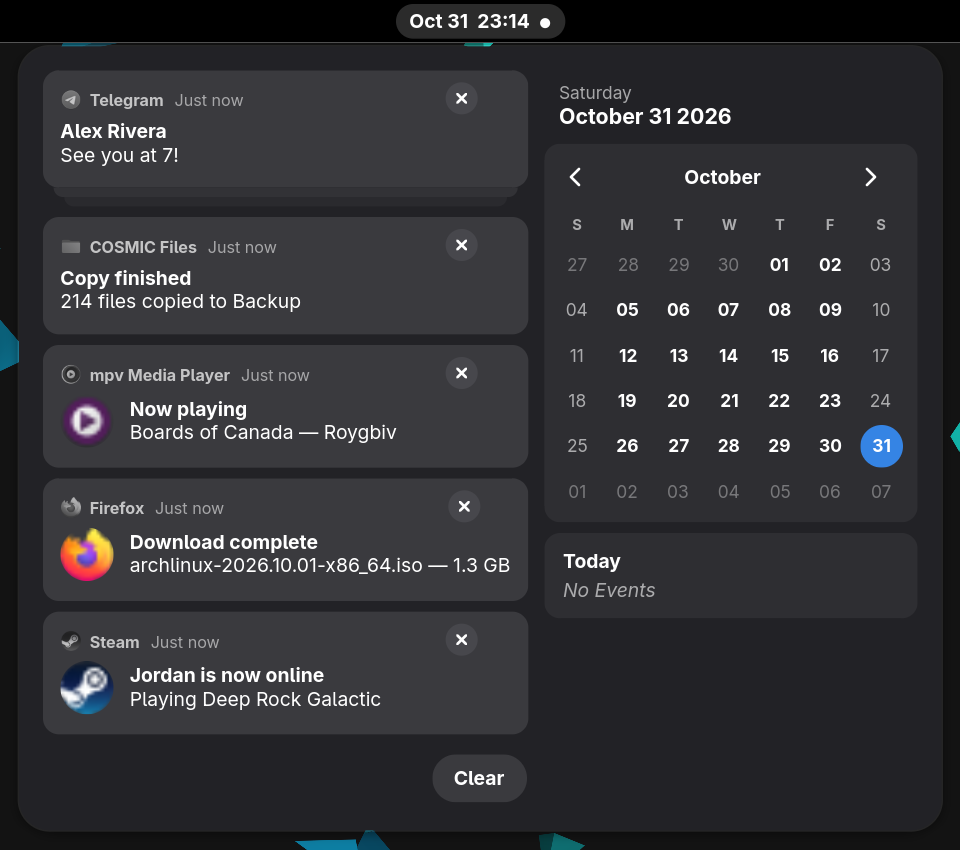
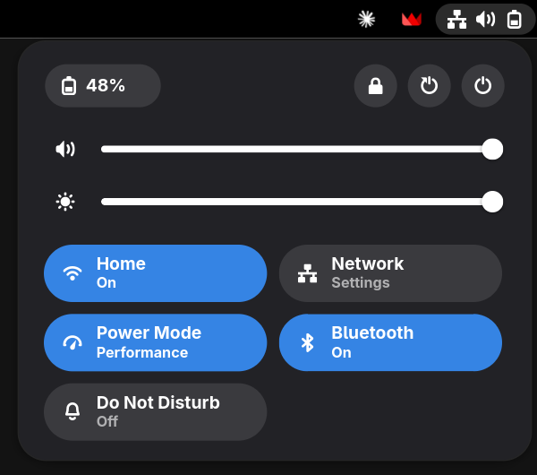

# ironbar-gnome

An [ironbar](https://github.com/JakeStanger/ironbar) config that mimics the GNOME Shell 51 top bar, for Hyprland.




- Workspace pills on the left
- Date and time in the centre, with an unread dot or a Do Not Disturb icon, opening GNOME's
  date menu: notifications on the left, one card per app with its other notifications as
  layers underneath (click a stack to expand it, ∨ to read a long message, × to dismiss),
  and Clear at the bottom left; on the right the date and a month calendar you can page through
- Status indicators on the right (network, volume, power mode when not Balanced, battery)
  opening GNOME's quick settings: battery, screenshot and power menu buttons, volume and
  brightness sliders (plus Night Light temperature while it is on), and Wired, Wi-Fi,
  Bluetooth, Power Mode, Night Light, Do Not Disturb, Keyboard (backlight) and Airplane Mode
  tiles, with GNOME's Power Mode, Keyboard and Power Off menus
- Sizes, colours and icons taken from a running GNOME 51

## Requirements

- ironbar 0.19
- NetworkManager (`nmcli`, `nm-connection-editor`), PipeWire (`wpctl`, `pactl`), UPower,
  power-profiles-daemon, `rfkill`, `bluetoothctl`, `brightnessctl`, `gdbus`
- dunst (`dunstctl`), `dbus-monitor` and `jq` for the notification list
- `hyprsunset` for Night Light, `grim`, `slurp` and `wl-copy` for screenshots
- `socat` for the workspace dots (it also makes updates faster by talking to ironbar's socket
  directly)
- Adwaita icon theme and Adwaita Sans font

## Install

```sh
git clone https://github.com/AuthenticSm1les/ironbar-gnome ~/.config/ironbar
```

The brightness slider reads `/sys/class/backlight/intel_backlight` with a maximum of 7500.
Adjust `value` and `max` of the brightness slider in `config.corn` for your backlight device
(see `/sys/class/backlight/*/max_brightness`).

A few icons (screenshot, keyboard backlight levels, the unread dot, notification
buttons) are GNOME Shell's own, not Adwaita's. If gnome-shell is installed, they are copied
once into `~/.local/share/icons/hicolor`, and stay there if you remove GNOME. Otherwise
similar Adwaita icons are used.

## Customising

ironbar reads `config.corn` and `style.css` and reloads them on save. The bar is laid out
in `config.corn`; styles are in `style.css`, by module.

## How it works

`scripts/qs.sh daemon` is started by the bar. It listens for Hyprland, NetworkManager, PipeWire,
UPower, power profile, rfkill and notification events, and pushes state into ironbar variables, so
nothing is polled except the slider positions (and Night Light and the keyboard backlight,
once a minute). Notifications are tracked from D-Bus while on screen and read from
dunst's history once closed; the menu shows up to five cards. State-dependent styles (tile
highlights, stacks, calendar days) come from a generated stylesheet that ironbar hot-reloads,
so things never resize the menus.
